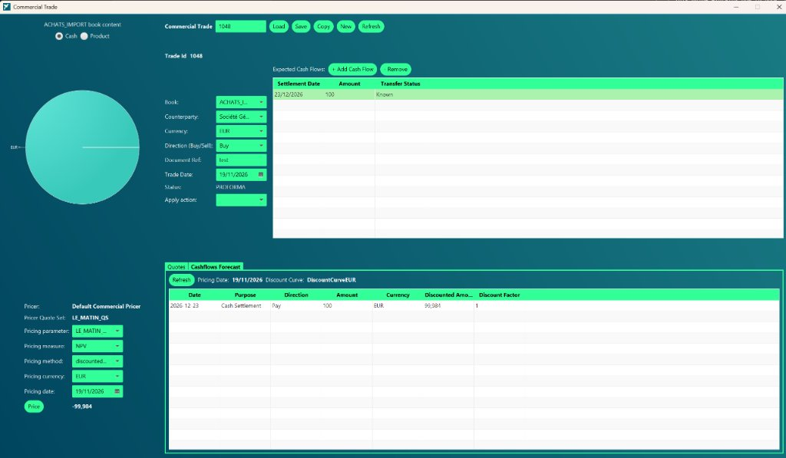
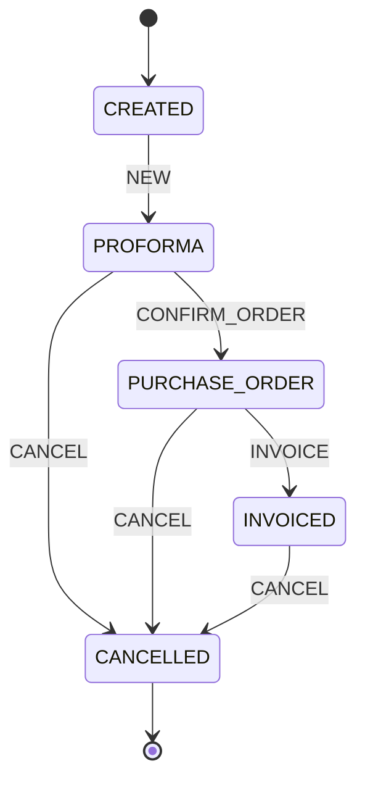

# User Guide: Commercial Trades & Cash Flow Management

This guide explains how to book, manage, price, and forecast **Commercial Trades** in Eclipse Tradista.

---

## 1. Overview & Trade Structure

A **Commercial Trade** represents a commercial contract, invoice, or purchase/sale commitment that generates one or more scheduled cash flows. It allows treasury and risk teams to track expected payments/receipts and include them in FX exposure and cash flow forecasts.

### Main Fields
* **Book & Counterparty**: The accounting book and commercial counterparty for the operation.
* **Currency**: The currency of the commercial cash flows.
* **Trade Date**: The date the commercial commitment is recorded.
* **Direction (`BUY` / `SELL`)**:
  * **`BUY`**: Outgoing cash flows (payments).
  * **`SELL`**: Incoming cash flows (receipts).
* **Document Reference**: Mandatory external reference identifying the commercial document (such as a purchase order or invoice number).
* **Cash Flow Schedule**: A table listing one or more expected cash flows, each with:
  * **Settlement Date**: Expected payment/receipt date (cannot be earlier than the Trade Date).
  * **Amount**: Positive cash flow amount.
  * **Transfer Status**: Current settlement status of the cash flow (e.g., `KNOWN` or `SETTLED`).

> [!TIP]
> You can add or remove rows in the Cash Flow Schedule directly from the trade screen. The total trade amount is automatically derived from the scheduled cash flows.

---

## 2. Workflow

Each Commercial Trade follows the **Commercial** workflow:

* When creating a new trade, saving applies the **`NEW`** action and moves the trade from **`CREATED`** to **`PROFORMA`**.
* When modifying an existing saved trade, you can select an available workflow **Action** (`CONFIRM_ORDER`, `INVOICE`, or `CANCEL`) before saving to transition the trade to the next status.
* Transitioning a trade to **`CANCELLED`** automatically cancels all of its pending (non-settled) cash transfers.

---

## 3. Cash Transfers & Settlement Tracking

Whenever a Commercial Trade is saved, Tradista automatically manages the corresponding **Cash Settlement** transfers:

* **New Trade**: One cash transfer is generated for each row in the Cash Flow Schedule, with status `KNOWN` (or `SETTLED` if already marked as settled) and direction `PAY` (`BUY`) or `RECEIVE` (`SELL`).
* **Updating a Trade**:
  * Cash flows whose transfer is already **`SETTLED`** are preserved and cannot be modified or canceled.
  * Pending (**`KNOWN`**) transfers are updated to reflect any changes to amounts or directions, or marked **`CANCELED`** if the corresponding cash flow row was removed.
* **Updating Transfer Status in the Screen**:
  * Rows are color-coded by transfer status for quick visual tracking.
  * A `KNOWN` row can be updated to `SETTLED` directly from the schedule table, while `SETTLED` rows are locked against further edits.

---

## 4. Pricing & Cash Flow Forecasting

The **Cashflows Forecast** and **Pricer** panels provide two independent actions as of a chosen **Pricing Date**:

### A. Cashflows Forecast
* Select the **Pricing Parameter** set (which determines the discount curve) and the **Pricing Date**.
* Click **Generate Cashflows** (or **Refresh**) to display all scheduled cash flows occurring on or after the **Pricing Date** (in the trade currency).
* If the selected Pricing Parameter set contains a discount curve for the trade currency, each cash flow displays its **Discount Factor** and **Discounted Amount**. Otherwise, a warning is displayed next to the curve name.
* Note: If the Pricing Date is after the trade's last settlement date, cash flow forecasting is not available.

### B. Pricing (NPV)
> [!NOTE]
> **What is NPV (Net Present Value)?**
> The **Net Present Value** represents the current value, as of the selected **Pricing Date**, of all remaining future cash flows on the trade after discounting them to account for the time value of money. It is positive when expected incoming receipts (`RECEIVE`) outweigh outgoing payments (`PAY`), and negative when outgoing payments outweigh receipts.

* Select the **Pricing Parameter** set, **Pricing Measure** (`NPV`), **Pricing Method**, **Pricing Currency**, and **Pricing Date**.
* Click **Price** to compute the **Net Present Value (`NPV`)** of the remaining cash flows as of the Pricing Date (outgoing `PAY` flows are counted negatively, incoming `RECEIVE` flows positively).
* If the **Pricing Currency** differs from the trade currency, the NPV is automatically converted into the Pricing Currency using the configured FX curve or market quotes.
