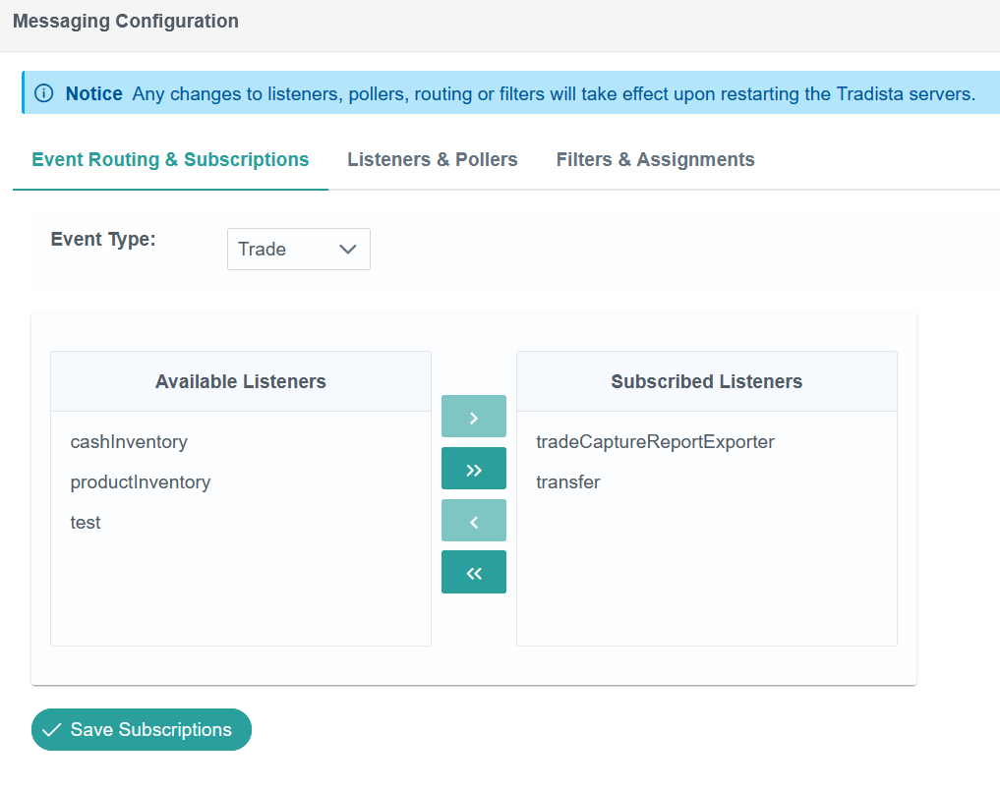
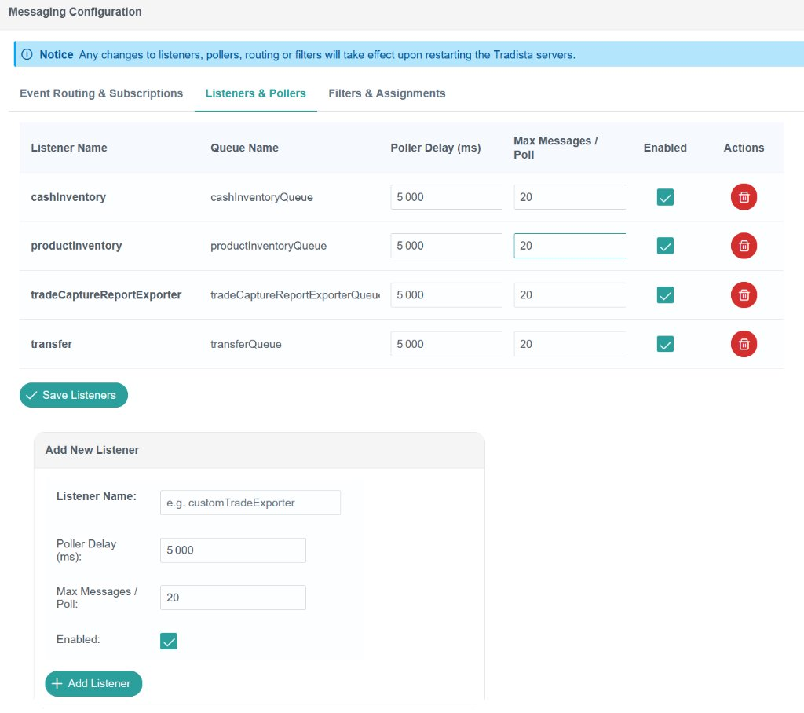
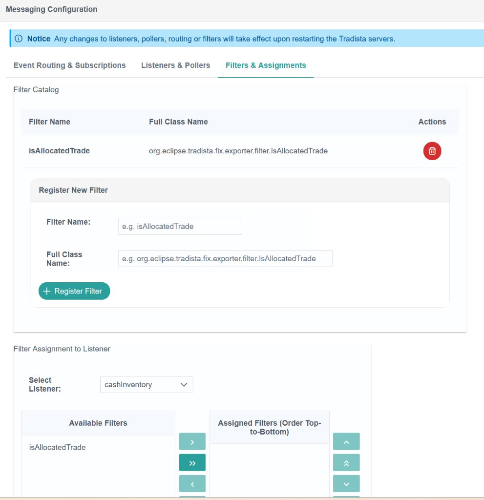

# User Guide: Messaging Configuration (Event Routing, Listeners & Filters)

This guide explains how **event-driven messaging** is configured in the Eclipse Tradista web interface (**Messaging Configuration**), allowing administrators to control how business events are routed to downstream listeners, how pollers behave, and how message filters are applied.

---

## 1. Overview

Eclipse Tradista uses an internal event-routing mechanism to decouple trade and transfer operations from downstream processing (such as transfer generation, cash/product inventory updates, and FIX trade capture exports):

* **Event Types**: Business events published by the platform (currently `Trade`, `CashTransfer`, and `ProductTransfer`; the mechanism is designed to be extended to additional domain event types in the future).
* **Listeners**: Consumers listening on dedicated message queues (e.g., `transferQueue`, `cashInventoryQueue`, `productInventoryQueue`, `tradeCaptureReportExporterQueue`).
* **Filters**: Optional rules assigned to a listener (in a defined execution order) to filter which events are processed.

> [!IMPORTANT]
> Modifying event subscriptions, listener settings, or filter assignments requires **Administrator** privileges. Changes take effect after **restarting the server**.

---

## 2. Web Interface Tabs

### A. Event Routing & Subscriptions
This tab defines which **Listeners** receive each **Event Type**:

1. Select an **Event Type** from the dropdown (`Trade`, `CashTransfer`, or `ProductTransfer`).
2. Use the picklist to move listeners between **Available** and **Subscribed** (target) lists.
3. Click **Save Subscriptions** to persist the routing configuration.

#### Default Subscriptions
Out of the box, Eclipse Tradista initializes the following subscriptions:
* **`Trade`** → `transfer` (`transferQueue`), `tradeCaptureReportExporter` (`tradeCaptureReportExporterQueue`)
* **`CashTransfer`** → `cashInventory` (`cashInventoryQueue`)
* **`ProductTransfer`** → `productInventory` (`productInventoryQueue`)

---

### B. Listeners & Pollers
This tab displays all registered listeners and allows tuning their polling behavior:

* **Listener Name**: Human-readable name of the listener.
* **Queue Name**: Underlying message queue name.
* **Poller Delay (ms)**: Interval in milliseconds between polling cycles (default: `5000` ms).
* **Max Messages / Poll**: Maximum number of messages processed per polling cycle (default: `20`).
* **Enabled**: Enables or disables the listener.

From this tab, administrators can:
* Edit polling parameters or toggle **Enabled**, then click **Save Listeners**.
* Delete a listener using the trash action button.
* Register a new listener in the **Add New Listener** panel and click **Add Listener**.

---

### C. Filters & Assignments
This tab allows registering message filters and assigning them to specific listeners:

1. **Register a New Filter**:
   * Enter a **Filter Name** and its **Full Class Name**, then click **Register Filter**.
2. **Assign Filters to a Listener**:
   * Choose a listener in **Select Listener**.
   * Move the desired filters into the assigned list and arrange their **execution order**.
   * Click **Save Filter Assignments** to apply.

#### Default Filters
Out of the box, Eclipse Tradista registers the `isAllocatedTrade` filter (filtering allocated trades) and assigns it to `tradeCaptureReportExporter`.

